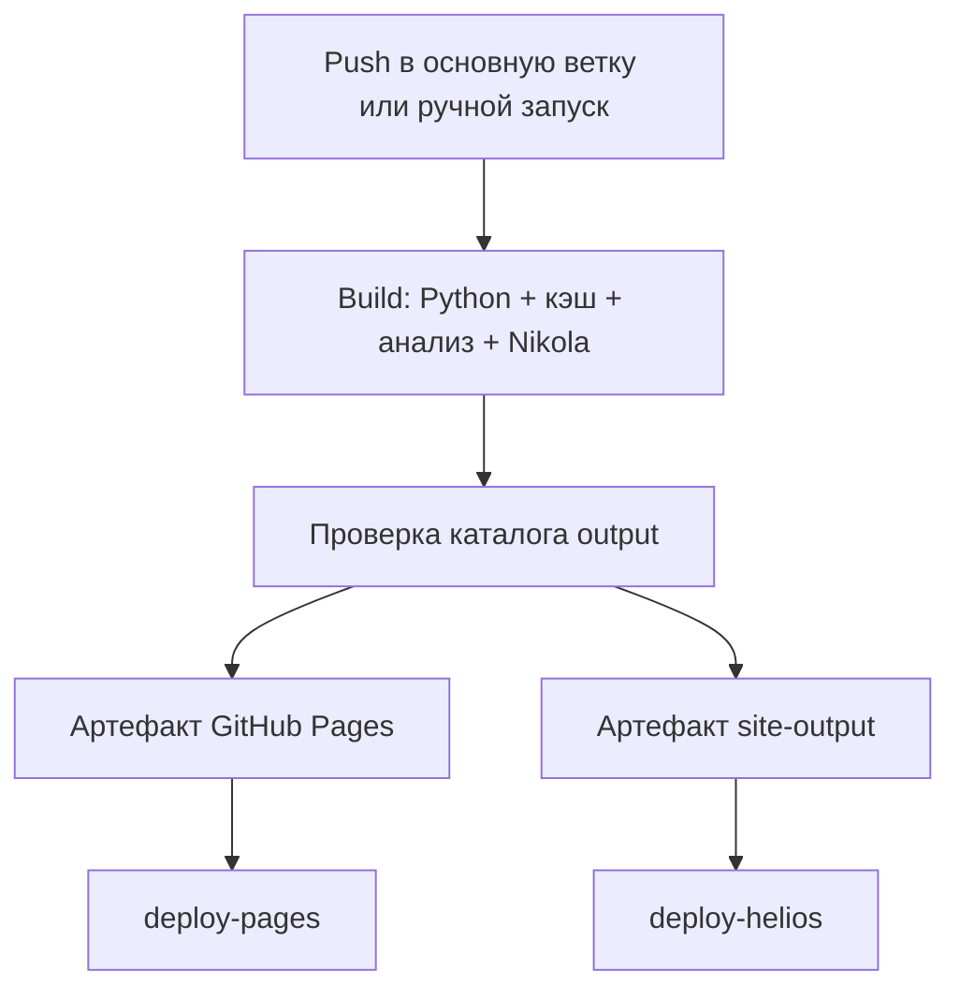

# Отчёт по практическому заданию P3

**Тема:** Воспроизводимый конвейер «данные → результат → сайт»  
**Проект:** Cache Research Lab  
**Назначение:** автоматизированная обработка демонстрационных результатов экспериментов по методам кэширования, генерация отчёта с таблицами и графиками и публикация статического сайта через CI/CD.

> **Перед сдачей:** замените плейсхолдер `HELIOS_LOGIN` в URL на свой логин, добавьте скриншоты в отмеченные места и дополните таблицу замеров результатами последнего запуска после настройки полного GitHub Actions-кэша.

## 1. Цель и задачи

Цель работы — реализовать воспроизводимый конвейер публикации экспериментальных результатов, в котором изменение исходных данных приводит к пересчёту метрик и обновлению сайта, а повторная сборка с неизменными входными данными может использовать ранее рассчитанные результаты.

В рамках задания реализованы следующие задачи:

1. Подготовлен набор демонстрационных данных об эффективности пяти методов кэширования.
2. Разработан Python-конвейер чтения данных, расчёта метрик, построения графиков и генерации страницы результатов.
3. Реализовано кэширование результатов анализа с проверкой актуальности по fingerprint исходных данных и программного кода.
4. Создан статический сайт на Nikola с готовой Bootstrap-темой.
5. Добавлена сборка сайта через Nox и измерение времени отдельных этапов.
6. Настроен GitHub Actions для автоматической сборки после `push` в основную ветку и по ручному запуску.
7. Настроено сохранение кэша анализа между запусками GitHub Actions.
8. Настроена публикация статического сайта на GitHub Pages и Helios.
9. Подготовлены таблицы, статические и интерактивные графики, формулы и перекрёстные ссылки для оформления результатов в научном стиле.

## 2. Результат работы

Создан сайт **Cache Research Lab**, представляющий результаты обработки демонстрационного набора данных. Сайт содержит главную страницу, описание эксперимента, страницу результатов и сведения о проекте.

- GitHub Pages: <https://virus1es.github.io/static-sites/>
- Helios: `https://se.ifmo.ru/~HELIOS_LOGIN/static-site/` — замените `HELIOS_LOGIN` на свой логин перед фиксацией отчёта в репозитории.

В качестве источника данных используется CSV-файл `data/experiment_results.csv`. На его основе формируются агрегированная таблица, CSV с рассчитанными метриками, статические PNG-графики, интерактивные графики Plotly и Markdown-страница с результатами.

### 2.1. Примечание о данных

Использованный набор данных является **демонстрационным (синтетическим)**. Он предназначен для проверки конвейера обработки, визуализации, кэширования и публикации. Значения ниже нельзя интерпретировать как результат проведённого полноценного экспериментального исследования на реальной нагрузке. При появлении фактических экспериментальных данных можно заменить CSV, не меняя общую архитектуру конвейера.

## 3. Использованные технологии

| Компонент | Назначение |
|---|---|
| Python 3.12 | Среда выполнения конвейера анализа и сборки |
| Nikola 8.3.3 | Генератор статического сайта (SSG) |
| Nox | Автоматизация воспроизводимых шагов сборки и измерение времени этапов |
| Pandas | Чтение CSV, группировка и расчёт агрегированных метрик |
| Matplotlib | Генерация статических графиков в PNG |
| Plotly | Генерация интерактивных графиков с подсказками при наведении |
| Jinja2 | Шаблоны, используемые в процессе генерации сайта |
| Bootstrap 4 / Bootswatch Flatly | Основа темы и компонентов интерфейса |
| `cache-lab` | Дочерняя тема Nikola, созданная на базе `bootstrap4-jinja` и Flatly |
| GitHub Actions | Автоматизация сборки и публикации |
| GitHub Actions Cache | Сохранение кэша анализа между workflow runs |
| GitHub Pages | Публикация сайта на GitHub Pages |
| SSH, SCP, `sshpass` | Передача файлов и выполнение команд на Helios в CI |
| Helios (FreeBSD) | Вторая площадка публикации статического сайта |

Локальная версия Python, зафиксированная во время настройки проекта, — Python 3.12.2. В одном из логов GitHub Actions использовался Python 3.12.14. В проекте версия Python ограничена в `pyproject.toml` условием `>=3.12,<3.13`; workflow должен использовать Python 3.12.

## 4. Структура проекта

Ключевые файлы и каталоги проекта:

```text
static-sites/
├── .github/
│   └── workflows/
│       └── deploy.yml       # CI/CD: сборка и публикация
├── data/
│   └── experiment_results.csv  # исходный набор данных
├── scripts/
│   ├── analyze.py           # координация конвейера
│   ├── config.py            # пути и настройки
│   ├── data.py              # загрузка и проверка данных
│   ├── metrics.py           # расчёт агрегированных метрик
│   ├── charts.py            # таблицы и графики
│   ├── report.py            # генерация страницы результатов
│   ├── version.py           # версия набора данных, commit и время сборки
│   └── cache.py             # проверка fingerprint и состояния кэша
├── pages/
│   ├── index.md             # главная страница
│   ├── experiment.md        # описание эксперимента
│   ├── results.md           # генерируемая страница результатов
│   └── about.md             # сведения о проекте
├── generated/               # генерируемые результаты анализа
├── images/generated/        # изображения, используемые сайтом
├── files/plots/             # интерактивные HTML-графики
├── themes/cache-lab/        # дочерняя тема Nikola
├── conf.py                  # конфигурация Nikola
├── noxfile.py               # сценарии сборки
├── pyproject.toml           # метаданные и ограничение версии Python
├── requirements.txt         # зависимости Python
└── .gitignore               # исключения для служебных и генерируемых файлов
```

Состав отдельных каталогов может дополняться в процессе дальнейшей разработки. Каталоги `generated`, `images/generated` и `files/plots` содержат производные материалы: их создаёт Python-конвейер, а не пользователь вводит вручную.

## 5. Обработка данных и результаты

### 5.1. Логика конвейера

Порядок обработки выглядит следующим образом:

1. Скрипт `scripts/analyze.py` загружает `data/experiment_results.csv`.
2. Модуль `scripts/data.py` проверяет ожидаемые столбцы и типы данных.
3. `scripts/metrics.py` рассчитывает агрегированные показатели по методам.
4. `scripts/charts.py` формирует CSV-таблицу, статические изображения и интерактивные графики.
5. `scripts/report.py` генерирует `pages/results.md` с таблицей, графиками, описанием методики и версиями сборки.
6. Nikola преобразует Markdown-страницы и шаблоны в HTML в каталоге `output/`.
7. GitHub Actions передаёт собранный сайт на площадки публикации.

### 5.2. Рассчитанные показатели

Для сравнения используются доля попаданий в кэш (`hit_rate`), доля промахов (`miss_rate`), средняя задержка (`latency_ms`) и стандартное отклонение задержки (`latency_std_ms`). В представленном наборе — 15 записей: по три запуска для каждого из пяти методов.

**Таблица 1 — Агрегированные результаты демонстрационного набора данных**

| Метод | Число запусков | Hit rate, % | Miss rate, % | Средняя задержка, мс | Стандартное отклонение, мс |
|---|---:|---:|---:|---:|---:|
| Adaptive | 3 | 82,77 | 17,23 | 68,60 | 0,98 |
| Cache Miss Prediction | 3 | 81,33 | 18,67 | 68,40 | 0,70 |
| LFU | 3 | 76,17 | 23,83 | 78,53 | 0,75 |
| LRU | 3 | 72,43 | 27,57 | 84,33 | 1,70 |
| Predictive | 3 | 84,67 | 15,33 | 63,47 | 1,23 |

По демонстрационным данным наибольшая доля попаданий и наименьшая средняя задержка получились у метода Predictive. Это описание только текущего синтетического набора данных; для научных выводов требуются повторяемые эксперименты на определённой нагрузке и с зафиксированной методикой.

### 5.3. Формируемые артефакты

Конвейер создаёт следующие файлы (конкретные имена могут зависеть от актуальной конфигурации скриптов):

- `generated/metrics.csv` — агрегированные метрики;
- `generated/results.md` — сгенерированный Markdown-отчёт;
- `generated/hit_rate.png` — статический график доли попаданий;
- `generated/latency.png` — статический график средней задержки;
- `generated/latency_distribution.png` — распределение задержки;
- `generated/interactive_hit_rate.html` — интерактивный график доли попаданий;
- `generated/interactive_latency.html` — интерактивный график задержки;
- `files/plots/hit_rate.html` и `files/plots/latency.html` — графики, подключённые к сайту.

Интерактивные графики позволяют получать значения показателей при наведении курсора. Для демонстрации автономности визуализации JavaScript Plotly включается в HTML графика, а не загружается только с внешнего CDN.

### 5.4. Оформление научных материалов

Для таблиц, рисунков и формул реализовано оформление в стиле, ориентированном на ГОСТ 7.32–2017:

- заголовок таблицы располагается над таблицей: `Таблица N — Название`;
- подпись рисунка располагается после изображения: `Рисунок N — Название`;
- формулы выводятся отдельно, нумеруются и сопровождаются пояснениями обозначений;
- в тексте используются перекрёстные ссылки на формулы, таблицы и рисунки.

Это оформление реализовано для учебного проекта и не заменяет финальную проверку всего документа по требованиям конкретной кафедры.

## 6. Кэширование и воспроизводимость

### 6.1. Кэш приложения

В `scripts/cache.py` рассчитывается fingerprint на основе входного CSV и файлов Python, участвующих в анализе. При совпадении fingerprint и наличии всех ожидаемых результатов повторный анализ пропускается. Если данные или аналитический код изменились либо обязательные выходные файлы отсутствуют, результаты пересчитываются.

Логика в общих чертах:

```text
experiment_results.csv + scripts/*.py
                  ↓
             fingerprint
                  ↓
       проверка состояния кэша
           ↙             ↘
  fingerprint совпал   fingerprint изменился
  и артефакты есть         или файлов нет
         ↓                      ↓
  Cache hit / skip         Cache miss / recalculate
```

Изменение `conf.py` не должно само по себе вызывать повторный расчёт экспериментальных метрик: оно влияет на конфигурацию сайта, а не на вычисления.

### 6.2. Кэш между GitHub Actions runs

GitHub-hosted runner создаётся заново для каждого выполнения workflow, поэтому его локальная файловая система не сохраняется автоматически. Для переноса кэша между запусками добавлен шаг `actions/cache`.

В кэш включены:

```text
.cache
 generated
 images/generated
 files/plots
```

В workflow ключ кэша строится из ОС, версии Python и хэша файлов входных данных, аналитического кода и файлов настройки зависимостей, в частности:

```yaml
key: ${{ runner.os }}-analysis-python3.12-${{ hashFiles('data/experiment_results.csv', 'scripts/*.py', 'requirements.txt', 'pyproject.toml') }}
```

Используется `restore-keys` с общим префиксом, чтобы GitHub мог восстановить предыдущий кэш при изменении ключа. После восстановления кэша окончательное решение о том, можно ли пропустить анализ, принимает сам `scripts/cache.py` на основании fingerprint и наличия ожидаемых выходных файлов.

**Важно при изменении состава `path`:** GitHub Actions cache entries неизменяемы. Если ранее по текущему ключу был сохранён только маленький каталог `.cache`, изменение списка каталогов без изменения ключа не гарантирует сохранение расширенного набора файлов: точное совпадение может продолжить восстанавливать старую запись. Поэтому после изменения состава кэшируемых каталогов нужно один раз увеличить версию префикса, например `analysis-v2-python3.12-...`, чтобы создать новую запись. После этого проверить, что размер восстановленного кэша больше прежних 458 байт и что скрипт действительно сообщает `Cache hit` / `Analysis skipped`.

Таким образом, GitHub Actions Cache отвечает за перенос файлов между runner'ами, а Python-кэш — за проверку актуальности данных.

### 6.3. Ожидаемое поведение

| Изменение | Ожидаемое поведение |
|---|---|
| Изменился только `conf.py` | Анализ использует существующие результаты; Nikola пересобирает сайт |
| Изменился `data/experiment_results.csv` | Fingerprint меняется, метрики и графики пересчитываются |
| Изменился файл в `scripts/*.py` | Fingerprint меняется, анализ выполняется заново |
| Кэш восстановлен, но выходных файлов не хватает | Анализ выполняется заново |
| Кэш не найден | Полный расчёт и сохранение нового состояния кэша |

## 7. Сборка через Nox

`noxfile.py` описывает запуск конвейера анализа и сборки Nikola. Для принудительного пересчёта предусмотрен отдельный сценарий `build_force`.

Основные команды:

```bash
# Запустить обычный конвейер: анализ с проверкой кэша и сборка Nikola
python -m nox -s build

# Принудительно выполнить анализ и затем собрать сайт
python -m nox -s build_force

# Запустить только анализ напрямую
python -m scripts.analyze
```

Nox создаёт изолированное окружение, устанавливает зависимости и запускает нужные шаги. Поэтому полное время Nox-сессии включает затраты на окружение и запуск процесса; оно не равно чистому времени вычислений внутри `scripts/analyze.py`.

## 8. Настройка CI/CD

### 8.1. Триггеры и сборка

Workflow находится в `.github/workflows/deploy.yml`. Он запускается при `push` в основную ветку и вручную через `workflow_dispatch`.

Основной job `build` выполняет следующие действия:

1. Получает исходный код репозитория.
2. Настраивает Python 3.12 и pip cache.
3. Восстанавливает GitHub Actions Cache анализа и производных файлов.
4. Устанавливает зависимости проекта и Nox.
5. Настраивает значения GitHub Pages, включая базовый URL.
6. Запускает `python -m nox -s build`.
7. Проверяет наличие обязательных страниц и графиков в `output/`.
8. Загружает артефакт для GitHub Pages и общий артефакт `site-output` для второго deployment job.

### 8.2. Почему деплои выполняются параллельно

После успешного `build` запускаются два независимых job: `deploy-pages` и `deploy-helios`. У каждого указан `needs: build`, но ни один из них не зависит от другого. Поэтому GitHub Actions может выполнять их параллельно.



Сайт строится один раз, а обе площадки получают результат одной и той же сборки. Это сокращает дублирование работы и уменьшает риск того, что на двух площадках окажутся результаты разных сборок.

### 8.3. Публикация на GitHub Pages

Для публикации используется выделенная цепочка GitHub Pages: настройка Pages, загрузка Pages artifact и deployment. В настройках репозитория источник публикации установлен в `GitHub Actions`.

В `conf.py` нормализуется `SITE_URL`: значение очищается от завершающих слешей и затем получает один завершающий `/`. Это устраняет некорректное склеивание базового URL с относительным путём страницы.

### 8.4. Публикация на Helios

Целевой каталог сайта:

```text
~/public_html/static-site/
```

Ожидаемый URL:

```text
https://se.ifmo.ru/~HELIOS_LOGIN/static-site/
```

Подключение выполняется по SSH к `helios.cs.ifmo.ru` через порт `2222`; передача файлов выполняется через SCP. В GitHub Secrets созданы секреты:

- `HELIOS_LOGIN` — логин студента на Helios;
- `HELIOS_PASSWORD` — пароль от Helios.

Пароль не хранится в YAML и не записывается в репозиторий. На шаге деплоя он передаётся инструменту `sshpass` через переменную окружения `SSHPASS`. Хост и порт не являются секретами и указываются в workflow.

Загрузка сначала выполняется во временный каталог `~/public_html/.static-site-next/`; после передачи файлов проверяется наличие основных HTML-страниц, затем новая версия активируется переименованием каталога. В успешном запуске сайт был опубликован и проверен в браузере.

**Замечание о восстановлении после ошибки:** в одном из присланных логов был показан вариант переключения `rm -rf ~/public_html/static-site && mv ...`. Между удалением старого каталога и перемещением нового в таком варианте нет гарантированного rollback. Если в актуальном `deploy-helios` используется именно эта последовательность, перед финальной сдачей следует заменить её на вариант с резервным каталогом `.static-site-previous`: переименовать действующий сайт в резервный, переместить новую версию на его место и восстановить резервную версию при неудаче. Не следует утверждать, что откат уже проверен, пока текущий YAML и соответствующий сценарий не проверены.

### 8.5. Секреты и безопасность

- Учётные данные Helios хранятся в GitHub Secrets.
- Секреты передаются шагу деплоя как переменные окружения.
- В репозитории не должны присутствовать пароль, токены или приватные ключи.
- Каталог публикации ограничен `~/public_html/static-site/`; команды удаления на сервере должны оперировать только заранее известными временным, резервным и рабочим каталогами.
- Дополнительное улучшение безопасности — закрепить и проверять известный SSH host key Helios, а не полагаться только на динамическое получение ключа при запуске workflow.

## 9. Проблемы, найденные в ходе выполнения, и решения

| № | Проблема | Причина/проверка | Принятое решение | Статус |
|---:|---|---|---|---|
| 1 | Ошибка рендеринга шаблона при первоначальной настройке темы Nikola | Выбранная комбинация темы `bootstrap3-jinja` и шаблона оказалась несовместимой с используемым шаблонным кодом | Создана дочерняя тема `cache-lab` на базе `bootstrap4-jinja` с Bootswatch Flatly | Исправлено |
| 2 | Ошибка плагина/окружения Jinja2 при запуске Nikola | Версия Jinja2 не соответствовала ограничениям используемого окружения Nikola | Зафиксировано совместимое ограничение `Jinja2>=3.1,<4` | Исправлено |
| 3 | Установка зависимостей падала на `contourpy==1.4.0` при Python 3.10/3.11 | Версия `contourpy` требует более новую версию Python | Проект и workflow приведены к Python 3.12; в `pyproject.toml` закреплено `>=3.12,<3.13` | Исправлено |
| 4 | `actions/configure-pages` завершался `Get Pages site failed: Not Found` | Pages ещё не был включён/настроен как источник публикации через Actions | В Settings → Pages выбран источник `GitHub Actions` | Исправлено |
| 5 | Ссылка строилась как `/static-sitesabout/` | `base_url` приходил без завершающего `/`, и он склеивался с маршрутом страницы | В `conf.py` URL нормализуется через `rstrip("/") + "/"` | Исправлено |
| 6 | GitHub Actions показывал `Cache hit`, но Python-скрипт выдавал `Cache miss` | В GitHub cache находился только каталог состояния `.cache` (в одном логе — 458 байт), но не существовали обязательные результаты анализа | В GitHub Actions Cache дополнительно включены `generated`, `images/generated` и `files/plots`; само приложение всё равно проверяет fingerprint и наличие результатов | Исправлено на уровне конфигурации; требуется зафиксировать лог чистого cache hit после изменения |
| 7 | SCP завершался `scp: error: unexpected filename: .` | Передавался путь `output/.` в legacy-режиме SCP (`-O`) | Источником для передачи выбран шаблон `output/*`, после чего публикация прошла успешно | Исправлено |
| 8 | HTML-таблица показывалась на странице как текст вместо таблицы | Сгенерированный фрагмент имел неподходящее форматирование/отступы в Markdown | HTML таблицы генерируется без лишних отступов и помещается в контейнер Bootstrap `table-responsive` | Исправлено |
| 9 | Формулы MathJax отображались как текст | Пользовательская настройка MathJax конфликтовала со встроенной настройкой Nikola; дополнительно требовалось корректное экранирование обратных слешей в строках Python | Убрана конфликтующая настройка, формулы формируются raw-строками, включена обработка математической разметки | Исправлено |
| 10 | Принудительный пересчёт было неудобно запускать через аргументы Nox | Аргумент `--force` не передавался скрипту ожидаемым способом | Добавлена отдельная сессия `build_force` | Исправлено |
| 11 | В workflow появились предупреждения об устаревшем Node.js 20 для GitHub Actions | У используемых версий Actions были сообщения о миграции на Node.js 24 | Версии используемых Actions обновлены/предусмотрены к обновлению; перед сдачей следует сверить теги в фактическом `.github/workflows/deploy.yml` | Требует финальной сверки YAML |

Для полноценного отчёта по требованию задания желательно приложить скриншоты как минимум трёх реальных ошибок из таблицы: первоначальной ошибки установки зависимостей, ошибки настройки GitHub Pages и ошибки `scp`. Таблица описывает их диагностику и устранение; скриншоты нужно добавить отдельно.

## 10. Измерения времени сборки

В ходе разработки замерялись как непосредственное время работы `scripts/analyze.py`, так и полное время этапа Nox. Эти показатели нельзя смешивать: время Nox включает запуск процесса и работу окружения, а время внутри анализатора измеряется самим скриптом.

### 10.1. Зафиксированные значения

| Сценарий и источник | Чистое время анализатора | Этап анализа в Nox | Сборка Nikola | Полный pipeline | Примечание |
|---|---:|---:|---:|---:|---|
| Локальный запуск анализа без действующего кэша | 0,730 с | — | — | — | Прямой запуск `python -m scripts.analyze` |
| Локальный запуск анализа с cache hit | 0,013 с | — | — | — | Анализ был пропущен, так как результаты актуальны |
| CI-запуск с пересчётом | 0,739 с | 1,851 с | 1,763 с | 3,615 с | Значения взяты из одного из логов GitHub Actions/Nox |
| CI-запуск после восстановления только `.cache` | 0,797 с | 3,093 с | 1,619 с | 4,712 с | GitHub Cache hit присутствовал, но Python-анализ дал cache miss из-за отсутствующих артефактов |
| Локальная принудительная сборка через Nox | 0,829 с | — | 3,547 с | 7,396 с | Полный Nox pipeline, включая накладные расходы окружения |
| Локальная сборка через Nox с пропуском анализа | 0,002 с | 3,241 с | 2,916 с | 6,157 с | Этап Nox заметно дольше чистого времени анализатора из-за накладных расходов |

Значения получены в разные моменты разработки и в разных окружениях. Это предварительные наблюдения, а не статистически достоверная оценка производительности: каждый показатель зафиксирован в ограниченном количестве запусков, а окружения и состояние кэша менялись.

В прямом локальном запуске анализ с актуальным кэшем занял 0,013 с против 0,730 с при расчёте. Это примерно в **56 раз быстрее** (сокращение времени примерно на 98 %), но вывод относится только к этим двум наблюдениям и не заменяет серию повторных измерений.

### 10.2. Замеры, которые нужно добавить после финальной настройки кэша

В последнем зафиксированном проблемном CI-логе GitHub восстановил только 458-байтовый каталог `.cache`. После включения в `path` дополнительных директорий кэша необходимо сохранить лог успешного повторного запуска, в котором `scripts.analyze` выводит `Cache hit` и `Analysis skipped`.

Заполните таблицу по двум-трём повторным запускам с неизменными данными и одному запуску после изменения CSV:

| Сценарий после финальной настройки | Запуск 1 | Запуск 2 | Запуск 3 |
|---|---:|---:|---:|
| `scripts.analyze`, кэш актуален | <!-- заполнить, с --> | <!-- заполнить, с --> | <!-- заполнить, с --> |
| Полный pipeline на GitHub Actions | <!-- заполнить, с --> | <!-- заполнить, с --> | <!-- заполнить, с --> |
| `scripts.analyze` после изменения CSV | <!-- заполнить, с --> | — | — |

Для воспроизводимого сравнения следует записать commit, версию Python, состояние кэша и время запуска. При изменении CSV необходимо вернуть файл к первоначальному состоянию после проверки либо сохранить изменение как осознанный пример нового набора данных.

## 11. Места для скриншотов

Добавьте изображения в каталог, например `docs/screenshots/`, а ниже замените комментарии на Markdown-ссылки вида ``.

1. **Главная страница Cache Research Lab.** <!-- TODO: вставить скриншот `docs/screenshots/01-homepage.png` -->
2. **Страница результатов:** таблица, подписи рисунков и формулы. <!-- TODO: `docs/screenshots/02-results.png` -->
3. **Интерактивный график Plotly с подсказкой значения.** <!-- TODO: `docs/screenshots/03-plotly-hover.png` -->
4. **Успешный workflow GitHub Actions с `build`, `deploy-pages` и `deploy-helios`.** <!-- TODO: `docs/screenshots/04-actions-success.png` -->
5. **Шаг восстановления кэша GitHub Actions (`actions/cache`).** <!-- TODO: `docs/screenshots/05-cache-restore.png` -->
6. **Лог `scripts.analyze` с `Cache hit` и `Analysis skipped`.** <!-- TODO: `docs/screenshots/06-analysis-cache-hit.png` -->
7. **Лог пересчёта после изменения `experiment_results.csv`.** <!-- TODO: `docs/screenshots/07-analysis-cache-miss.png` -->
8. **Успешная публикация на Helios и открытый сайт.** <!-- TODO: `docs/screenshots/08-helios-deploy.png` -->
9. **Успешная публикация на GitHub Pages.** <!-- TODO: `docs/screenshots/09-pages-deploy.png` -->
10. **Примеры ошибок до исправления:** минимум три отдельных скриншота. <!-- TODO: `docs/screenshots/10-errors/` -->

## 12. Воспроизведение локально

Для повторного запуска конвейера в окружении с Python 3.12:

```bash
python -m pip install -r requirements.txt
python -m pip install nox
python -m nox -s build
```

Для принудительного пересчёта результатов:

```bash
python -m nox -s build_force
```

В CI используются те же исходники и зависимости; после успешной сборки каталог `output/` проверяется и передаётся deployment jobs в виде артефактов.

## 13. Выводы

В рамках задания реализован воспроизводимый конвейер «данные → результат → сайт». Аналитическая часть отделена от генератора статического сайта: Python-скрипты рассчитывают метрики и формируют графики, а Nikola преобразует страницы и результаты в HTML. Для ускорения повторных запусков реализован кэш на уровне приложения и сохранение необходимых каталогов между GitHub Actions runs.

Сборка сайта выполняется один раз в общем job `build`, после чего один и тот же артефакт передаётся независимым job публикации. Благодаря тому, что `deploy-pages` и `deploy-helios` зависят только от `build` и не зависят друг от друга, оба деплоя могут выполняться параллельно. Это исключает повторную сборку сайта для каждой площадки.

В ходе выполнения были устранены проблемы совместимости зависимостей, настройки GitHub Pages, формирования базового URL, сохранения артефактов кэша, формирования HTML-таблицы и рендеринга формул, а также передачи файлов на Helios через SCP. Сайт успешно публиковался на GitHub Pages и Helios.

Для завершения отчёта необходимо добавить скриншоты успешного CI/CD и ошибок до исправления, снять итоговые замеры cache hit после последнего изменения конфигурации кэша и сверить актуальный `deploy-helios` на предмет отката при неудачном переключении версии сайта.

## 14. Полезные ссылки

- [Nikola — документация](https://getnikola.com/)
- [Nox — документация](https://nox.thea.codes/)
- [GitHub Actions — кэширование зависимостей и файлов](https://docs.github.com/en/actions/using-workflows/caching-dependencies-to-speed-up-workflows)
- [GitHub Pages — использование custom workflows](https://docs.github.com/en/pages/getting-started-with-github-pages/using-custom-workflows-with-github-pages)
- [GitHub Actions Cache](https://github.com/actions/cache)
- [GitHub Pages: configure-pages](https://github.com/actions/configure-pages)
- [GitHub Pages: deploy-pages](https://github.com/actions/deploy-pages)
